  

<!-- CAFFEINE-METER:START -->
<picture>
  <source media="(prefers-color-scheme: dark)" srcset="https://raw.githubusercontent.com/noonyuu/noonyuu/output/caffeine-dark.svg">
  
</picture>
<!-- CAFFEINE-METER:END -->

## 🤝 Connect

[X - @noonyuu](https://X.com/noonyuu)

[Portfolio](https://noonyuu.com)

[すごい開発者](https://sugoikaihatusha.com)
