  

<!-- 2. プロフィールや連絡先を変更 -->

<!-- CAFFEINE-METER:START -->
<picture>
  <source media="(prefers-color-scheme: dark)" srcset="https://raw.githubusercontent.com/noonyuu/noonyuu/output/caffeine-dark.svg">
  
</picture>
<!-- CAFFEINE-METER:END -->

## 🤝 Connect

[X - @noonyuu](https://X.com/noonyuu)

<!-- 3. 好きな技術スタックに変更 -->
<!-- ライトモート：theme=light, ダークモート：theme=dark -->
<!-- アイコンの選択肢一覧：https://arc.net/l/quote/zizyykfh -->

## 🌱 Learning Skills

### My Favorite

 

#### Languages

 

#### Other

 
